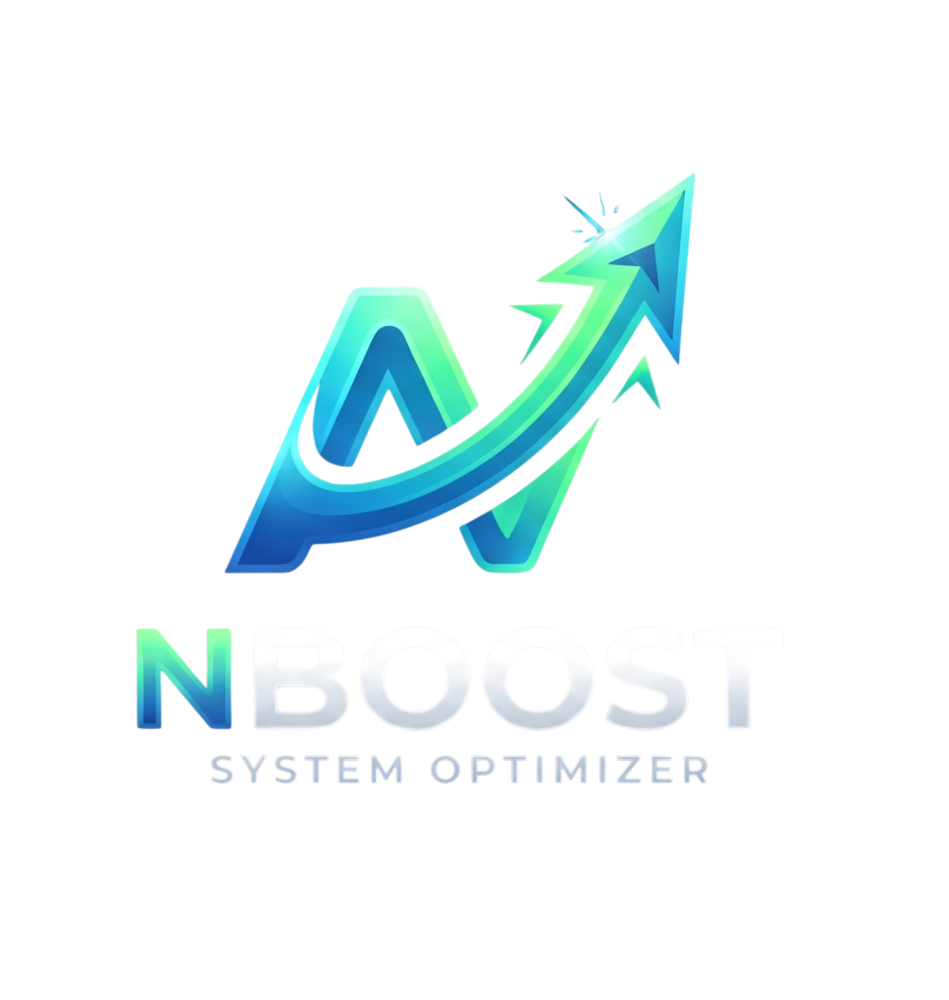

<p align="center">
  
</p>

<h1 align="center">Nboost</h1>
<p align="center"><b>A dark, cyber-neon glassmorphism system cleaner & optimizer for Windows.</b></p>

<p align="center">
  <a href="https://t.me/nengzx_fernandez"></a>
  <a href="https://github.com/NengzXGODZ"></a>
  
  
</p>

---

## What it is

Nboost is a PyQt6 desktop app with:

- **Sidebar navigation** — Dashboard, Cleaner, Advanced, About
- **Live CPU / RAM / Disk gauges** — animated circular neon gauges, polled every ~1.2s
- **Real-time cleaning log console** — color-tagged, timestamped output as each job runs
- **Checkbox-driven cleaning modules** so you choose exactly what runs
- **Scan button** that dry-runs every selected module and reports total recoverable space before anything is touched
- **One-Click Boost** that runs every module in one pass
- **Animated progress bar + pulsing boost button**
- Hard-coded **safety exclusions** so nothing in `Windows`, `System32`, `Program Files`, saved browser passwords, etc. is ever touched

## Modules

**1. Junk & Temp Cleaner**
Windows Temp, User Temp (`%temp%`), Prefetch, Crash Dumps, Recycle Bin.

**2. Log & Cache Cleaner**
Windows Event Logs (`wevtutil`), Windows Update cache (`SoftwareDistribution\Download`, with `wuauserv` stopped/restarted automatically), Thumbnail/Icon cache, DNS cache (`ipconfig /flushdns`).

**3. Browser & App Cleaner**
Cache, cookies and temp files for **Chrome**, **Edge**, **Discord**, and **Steam** — saved passwords, autofill/card data (`Login Data`, `Web Data`, `logins.json`, `key*.db`) are explicitly skipped, never deleted.

**4. Advanced System Optimization**
- **Standby RAM cache purge** — the same `NtSetSystemInformation(SystemMemoryListInformation)` technique RAMMap's "Empty Standby List" uses, plus a system-wide working-set trim.
- **Broken registry entry scanner** — flags `Run`/`Uninstall`/`App Paths`/`MUICache` string values that point at files that no longer exist; before deleting anything it writes a restore `.reg` backup to your Documents folder.
- **Large duplicate file finder** — size-bucket → partial-hash → full-hash pipeline across Downloads/Documents/Desktop/Pictures/Videos, ≥25 MB by default.
- **Startup program manager** — enable/disable (never delete) entries from Run keys and the Startup folder.

## Safety exclusions (always on)

- `Windows`, `System32`, `SysWOW64`, `WinSxS`, `Boot`, `Program Files`, `Program Files (x86)` are refused by every module, no checkbox overrides this.
- Credential files (`Login Data`, `Web Data`, `logins.json`, `key3.db`/`key4.db`, etc.) are skipped by name inside browser/app cache folders.
- Registry cleanup never touches `SYSTEM`/`SECURITY`/`SAM` hives, `Winlogon`, or Image File Execution Options, and always backs up what it's about to delete.
- Startup toggles are reversible renames/key-moves, never deletions.

Run as **Administrator** for full access (Event Logs, Windows Update cache, standby RAM purge); without it those steps are skipped safely and logged as such.

## Running from source

```bash
git clone https://github.com/NengzXGODZ/Nboost.git
cd Nboost
python -m venv .venv
.venv\Scripts\activate
pip install -r requirements.txt
python main.py
```

Windows only (uses `winreg`, `ctypes.windll`, `wevtutil`, `sc`, `ipconfig`). For full functionality, run your terminal as Administrator before `python main.py`.

## Building a standalone .exe

```bash
build_exe.bat
```

or manually:

```bash
pip install -r requirements.txt
pyinstaller nboost.spec --noconfirm
```

Output lands at `dist/Nboost.exe` — single file, windowed, bundled icon and theme, UAC-elevated by default (set via the spec's `uac_admin=True`).

### Building the installer (Inno Setup)

```bash
build_installer.bat
```

or manually, once `dist\Nboost.exe` exists:

```bat
"C:\Program Files (x86)\Inno Setup 6\ISCC.exe" installer\nboost.iss
```

Output: `installer\Output\NboostSetup.exe` — Start Menu + optional desktop
shortcut, installs to Program Files, admin-elevated installer and app.

See [`BUILD.md`](BUILD.md) for details and troubleshooting.

## Project structure

```
Nboost/
├── main.py                    # entry point
├── nboost.spec                 # PyInstaller build spec
├── build_exe.bat
├── build_installer.bat         # builds the exe then runs Inno Setup
├── installer/
│   └── nboost.iss               # Inno Setup 6/7 installer script
├── requirements.txt
├── nboost/
│   ├── main_window.py          # sidebar, pages, gauges, console wiring
│   ├── core/
│   │   ├── safety.py            # protected paths/registry keys/credential files
│   │   ├── system_monitor.py     # CPU/RAM/Disk polling thread
│   │   ├── cleaner_engine.py      # Modules 1-3 job functions
│   │   ├── ram_optimizer.py        # standby list purge / working-set trim
│   │   ├── registry_tools.py        # broken entry scan + backup + delete
│   │   ├── duplicate_finder.py       # size/hash duplicate pipeline
│   │   ├── startup_manager.py         # Run-key / Startup-folder toggler
│   │   ├── jobs.py                     # checkbox-key -> job function registry
│   │   ├── workers.py                   # QThread wrappers for every job
│   │   └── paths.py                      # resource path resolution (dev + frozen)
│   ├── widgets/
│   │   ├── gauge_widget.py       # QPainter neon circular gauge
│   │   └── console_widget.py      # color-tagged log console
│   └── resources/
│       ├── theme.qss              # dark glassmorphism stylesheet
│       ├── nboost.png              # app logo
│       ├── nboost.ico               # app icon (Windows)
│       └── icons/              # all UI icons are SVG (no emoji anywhere)
│           ├── dashboard.svg, cleaner.svg, gear.svg, info.svg   (nav)
│           ├── search-dark.svg, broom-dark.svg                  (scan/clean)
│           ├── rocket-light.svg                                  (boost)
│           ├── telegram.svg, github.svg                          (dev links)
└── LICENSE
```

## Developer

Built by **NengzXGODZ** — [Telegram](https://t.me/nengzx_fernandez) · [GitHub](https://github.com/NengzXGODZ)

## License

MIT — see [LICENSE](LICENSE).
